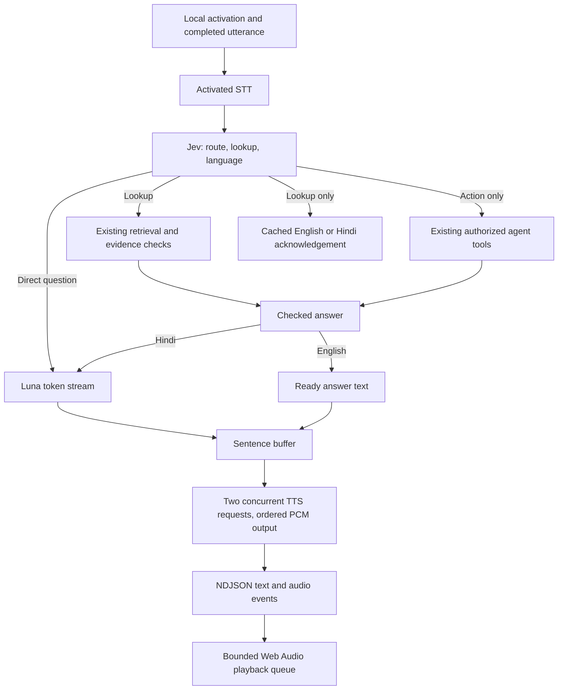
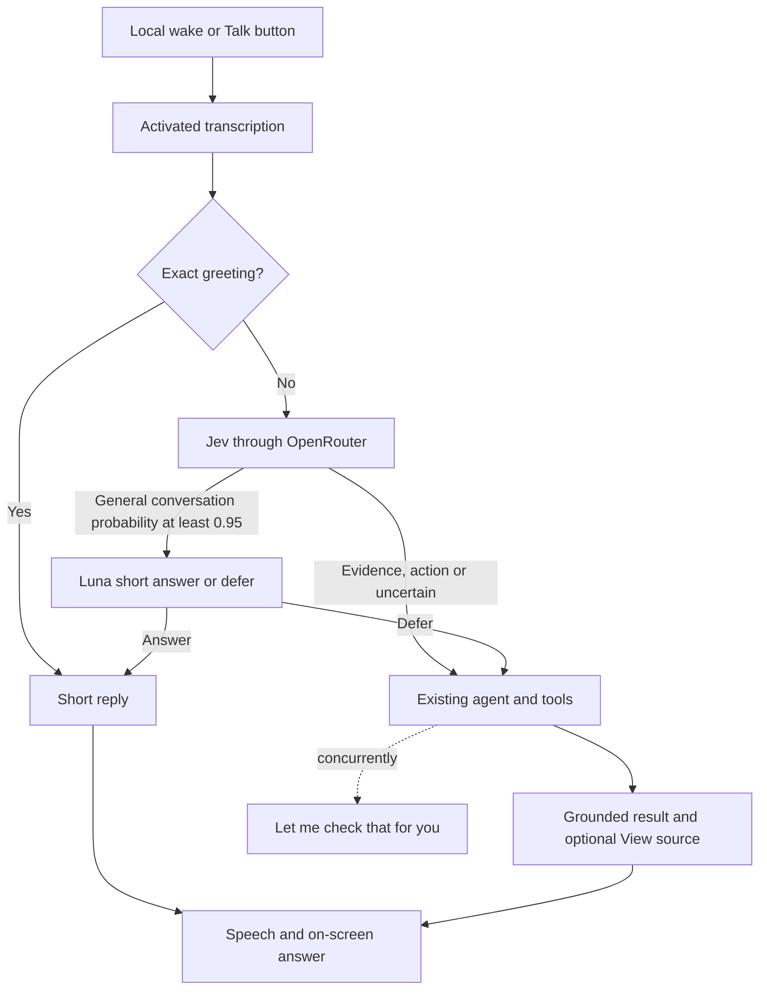

# Technical architecture

## Companion voice selection — 2026-10-31

The current voice is Shalini Companion: `shalini_en_companion` for English and
`shalini_hi_companion` for Hindi, using Bulbul v4 Flash. This replaces the Ritu
Reels/conversation presets described below. Answers, reminder speech and cached
acknowledgements use the matching language preset. “Companion” is a speaker persona,
not an additional conversation engine or separate API mode.

## LiveKit Agents voice migration — 2026-10-31

Spoken conversations now run through LiveKit Agents 1.8.10. The browser streams
20 ms mono PCM frames over the authenticated local `/api/voice/live` WebSocket;
custom LiveKit audio input/output adapters connect that socket to `AgentSession`.
This uses LiveKit's conversation runtime without a separate LiveKit room server.
LiveKit owns turn completion, interruption, LLM streaming, sentence-aware TTS and
speech scheduling. The old utterance upload, Jev voice router, NDJSON reply loop,
and custom sentence-synthesis workers have been removed. Typed requests retain
the existing bounded visual agent.

Sarvam `saaras:v4` uses `/speech-to-text-realtime/ws`, fast partial transcripts,
server VAD (400 ms silence, 250 ms minimum speech), `Nyx` keyterms and a short
English/Hindi terminology prompt. LiveKit adds no extra endpointing minimum.
The small STT protocol adapter is necessary because the installed Sarvam plugin
uses the legacy STT endpoint. Application pings keep the socket open without
uploading idle audio. Auto language detection is not a hard two-language decoder
restriction; English/Hindi are the supported response languages.

Sarvam `bulbul:v4-flash` uses the LiveKit WebSocket TTS plugin at 24 kHz. Ritu
(`ritu_en_reels`, `ritu_hi_conversation`) replaces Shubh. Twelve cached clips use
the same voice settings. A lookup starts its cached acknowledgement alongside
the tool; a general question has no checking filler. Missing clips skip filler
rather than adding synthesis latency. The streamed LLM selects tools directly;
visual tool calls bypass the old duplicate planner and return checked evidence.
The existing authorization and evidence validation still apply.

Local wake detection remains separate from conversational endpointing. Initial
LiveKit listening does not activate cloud audio. Explicit activation/wake and a
short follow-up window gate outgoing audio. Source checks, cancellation, playback
segment IDs and browser epochs prevent obsolete results/audio from completing a
new turn. Logs include provider request IDs, STT endpoint-to-final delay, LLM TTFT,
TTS first-byte time and browser playback-start timing after the transcript.

The earlier streaming sections below describe superseded implementations.

## Streaming speech latency update — 2026-10-31

The running demo selects `NYX_TTS_MODEL=bulbul:v4-flash` with the existing server-only
`SARVAM_API_KEY`. Sarvam HTTP streaming supplies mono 24 kHz linear16 through the same
bounded sentence/audio pipeline. Both full acknowledgement generation and streamed
answers use `shubh_enhi_companion`; all 12 English/Hindi clips were regenerated locally.
This supersedes the earlier Kore preference for the user's requested speed improvement.
The existing OpenRouter speech option remains the default when NYX_TTS_MODEL is unset.
No silent provider fallback is used. Measured synthesis first audio was 253–390 ms versus
2164–2761 ms previously; this is a small synthetic comparison, not end-to-end latency.

Frame decode and verification now overlap per frame with bounded concurrency and ordered
results. Context-only questions skip the statement-check model; actual statement checking
depends on the selected frame and remains after verification. Retrieval depends on the
resolved query, and speech depends on the checked answer. Existing acknowledgement/tool
work and token generation/sentence synthesis already overlap. See R6 for evidence.

## Streaming speech pipeline — 2026-10-31



`cloud.py` parses bounded SSE token streams and incrementally reads PCM responses.
`speech.py` holds punctuation-aware sentence buffering (English/Hindi, decimal and
abbreviation handling), three waiting sentences, two synthesis requests, bounded
per-sentence audio queues and 16 outbound events. Long unpunctuated clauses split
at whitespace. Playback schedules 24 kHz mono samples without dropping odd-byte
transport fragments; the browser limits queued audio to roughly three seconds.

`/api/voice/reply` accepts `stream: true` and returns NDJSON text/audio/done/error
messages. Existing session, turn, job, source and cancellation checks still apply.
A completed stream persists its answer; failed/cancelled streams are interrupted.
A stop, wake interrupt or disconnect signals cancellation, drops queued audio and
closes streaming iterators. Already-running provider calls may remain blocked
until bytes arrive or the 30-second transport timeout; cancellation cannot undo
provider billing. Browser playback has its own epoch guard and AbortController.

Only voice output uses this pipeline. Typed input retains its agent flow. STT still
accepts a completed activated utterance; no idle audio is streamed to the cloud.
Tool/planner JSON and evidence checks must complete validation before their results
can be spoken. Frame decoding and visual checks run in bounded parallel batches;
ordering, candidate scope and timestamps are unchanged.


## Conversation time handling — 2026-10-31

`voice.py` formats elapsed sightings by subtracting aware timestamps, so relative time is independent of timezone and DST. `local_now` uses the browser IANA zone; clients omitting it use the laptop local timezone. Typed requests carry `timezone`; voice requests carry `x-nyx-timezone`. Current-clock replies bypass generation. The companion supplies local `now` and `user_timezone` to the planner; storage and temporal filtering continue using UTC. Speech and main text share the same short historical answer; evidence metadata remains exact.


## Fast spoken turns — 2026-10-31



`CloudVoice.route` owns this small voice-only gate. `OpenRouter.request` retains
bounded transport and data-collection restrictions for both v1 and alpha APIs.
Recent completed turn text supplies routing context. A direct reply has no images
or tools and cannot intentionally claim a sighting or completed action; model
misclassification remains possible. Personal recall and ambiguous follow-ups route
to the agent. No capability is added to the agent itself.

`/api/voice/acknowledgement` checks the live session, turn and cancellation epoch
before and after synthesis, without completing the turn. The browser also checks
that tool work is still pending before playing it. The fixed line uses the existing
bounded speech cache. A failed acknowledgement does not prevent the actual answer.


## Conversation presentation — 2026-10-31

Packaged web assets retain the existing capture, agent and voice APIs. `companion.js` renders
the current conversational question/answer and shared controls; voice state and capture/evidence
changes emit browser events to refresh those controls. Native dialogs provide focus handling
for source inspection and settings. Closing a source pauses replay. New turns clear previous
source access so evidence from an older answer is not attached to a new conversation.
No framework, build process or additional provider is introduced.


## Speech-linked finding and surrounding replay — 2026-10-28

Historical matches now replay up to ten seconds before and after the sighting,
across available segments in the same reliably timed capture session. Gaps are
not reconstructed. Imported or uncertain recordings use clip-local bounds.

The history tool searches captured user transcripts by object words or within
90 seconds of the sighting (30 candidates). The visual model selects at most two
existing transcript IDs. Exact quotes are attributed separately from visual
findings; intended placement is not confirmed placement. This bounded feature
is not general long-term semantic memory. Listen now (30 seconds) bypasses missed
wake activation; ignored wake attempts stay quiet in the conversation UI. Idle audio is not
archived, so missed statements cannot be recovered.


## Cloud MVP architecture — 2026-10-28 (current)

This supersedes the local-inference model/runtime sections below, which record
how the prototype evolved. One Python server and browser remain; no new service
framework or dual local/cloud inference stack is introduced.

Camera -> local temporal activity filtering -> selected images -> OpenRouter
multimodal embeddings -> local SQLite vectors and source timestamps. User message
-> cloud agent -> local tools for current image/history/reminders -> cloud visual
interpretation -> evidence-linked answer -> cloud TTS -> browser playback.

`cloud.py` owns bounded HTTPS transport, image encoding, safe errors and response
validation. `verification.py` owns cloud agent/vision prompts and judgment parsing.
`perception.py` owns cloud image/text embeddings and their identity. `voice.py`
retains local wake/turn/cancellation state with OpenRouter activated STT/TTS.
The tiny CPU detector and inexpensive image-change window remain local. MLX/Qwen,
local SigLIP inference and Sarvam runtime paths have been removed.

The models and run commands are in README. Vector dimensions and preprocessing
are fingerprinted; `nyx reindex` rebuilds saved sample vectors atomically while
preserving source IDs, times and files. Failed rebuilds leave the original index
usable. Run it with the server stopped. No implicit startup rebuild or private
media upload occurs in developer tests.

Calls have a 45-second network timeout, bounded outputs, no automatic retry and
no local fallback. Provider errors become visible failures/uncertainty. Existing
job/voice cancellation discards late results; it cannot cancel a billed upstream
request already sent. Keys stay backend-only. Selected images and activated audio
leave the device; full recordings and idle audio do not. Requests set
`provider.data_collection=deny`, which is not a zero-retention guarantee.


Status: working architecture, 2026-10-19. M1 has local clip import/sampling, encoder inference, SQLite retrieval, a CLI and an HTML gallery. The M2 localhost interface adds enabled rolling recording, automatic background indexing, interactive search and separate source playback. M3 now adds bounded temporal retrieval and local model checking; M4 adds local wake listening with Sarvam activated-question voice; a bounded companion/event-request slice was added on 2026-10-20. [Decisions](decisions.md) distinguishes established preferences from open selections.

## Shape of the system

One Python application owns capture, persistence, retrieval, tool execution, and reminders. A small browser interface owns interaction and evidence playback. Model inference runs outside the API request/event loop so recording and controls remain responsive.

```text
Camera / imported video
  -> timestamped recording files
  -> selected frames or clips
  -> small visual encoder
  -> SQLite vectors + source metadata

Question -> backend tool -> current frame OR historical candidates
  -> on-demand visual inspection / verification
  -> evidence-backed result -> cloud voice -> person

Assistant conversation / explicit remembered fact / reminder
  -> attributed SQLite records -> retrieval / scheduling
```

Start with in-process queues and a single controlled inference worker. Add process separation only where actual blocking behavior or reliability requires it. No message broker or distributed service topology is needed for the laptop demo.

## Responsibilities

| Component | Owns | Boundary |
| --- | --- | --- |
| Capture | Recording segments, current frames, scene/view identity, actual capture times and gaps | It does not decide what a scene means. |
| Perception | Image/text embeddings and on-demand frame/clip inspection | Outputs include model/version and uncertainty; inference failures remain failures. |
| Retrieval | Query encoding, filters, candidate ranking, source lookup, and verified-sighting selection | Candidate similarity is not a probability or proof. |
| Memory | SQLite records, vectors, transcripts, notes, source links, retention and deletion | Storage does not supply interpretation or establish evidence truth. |
| Voice | Cloud session, audio turn state, interruption, transcript and tool-result exchange | Permanent credentials stay backend-side; tools own durable facts and actions. |
| Actions | Reminder scheduling and note operations | State persists; retries do not create duplicate actions. |
| Browser UI | Conversation controls, setup, status, search results, playback and memory controls | It presents verified findings and candidates distinctly. |

## Model choices and runtime

The baseline candidate is a small image/text encoder such as CLIP or SigLIP. Both sides of a similarity query must use compatible representations from the same checkpoint/preprocessing scheme. Store model ID, revision, dimensionality, and preprocessing identity; never mix incompatible vectors in one searchable index.

Use a VLM on demand to inspect a current scene or verify retrieved candidate moments. Compare small local candidates before selecting a checkpoint. MLX-VLM is an optional inference library for supported Apple Silicon VLMs; PyTorch/Transformers is another path. The application should isolate the calls it actually needs without building a general provider framework.

JEPA produces visual representations and supports research into temporal features/prediction. Text search over its representations requires an additional alignment or retrieval mechanism. Test its contribution against a simple baseline before adding it to the application. LeRobot may become relevant to future robot hardware/control work; it is not a dependency of this laptop memory demo.

Current local hardware was observed as an M4 Pro with 24 GB unified memory. This establishes the test machine, not inference throughput or usable memory under load. The pinned SigLIP 2 baseline has run on MPS; see [R3 findings](research/R3-local-retrieval.md) for measurements and limitations. Python 3.12 and uv now define the baseline environment; optional vision dependencies are separated from the deterministic test setup.

## Retrieval flow

1. Record media or import a clip; preserve known capture metadata and unknowns.
2. Sample periodically and/or after useful visual changes. Record the sampling policy and coverage.
3. Embed frames and store vectors with segment, scene, capture time, clip offset, and thumbnail references.
4. Encode a descriptive query using the matching text encoder; apply requested time/scene filters and retrieve candidates.
5. Inspect original frames or denser clip samples when a verified answer is needed. Whole-frame embeddings may miss small objects; benchmark crops or another retrieval path if necessary.
6. Return grounded findings linked to evidence. A last-seen answer uses the latest verified sighting within searched coverage; top similarity alone cannot establish it.

Temporal questions such as “last,” “before,” or “this afternoon” require explicit time handling. Broad household questions may need query interpretation in addition to visual embeddings. Validate these separately from simple descriptive retrieval.

## Data contract

| Record | Essential information |
| --- | --- |
| Recording | ID, source/camera, scene ID, path, known capture start/end, import time, coverage/status |
| Frame / clip | Source recording, exact offset or interval, actual capture time when known, preview reference |
| Embedding | Evidence ID, model ID/revision, preprocessing identity, dimension, vector |
| Finding | Source evidence, grounded description, verification state/method, uncertainty |
| Utterance | Session, speaker, transcript, occurred-at time |
| Saved fact | User-attributed content, created-at time, source, correction/supersession history |
| Reminder | Original request, resolved time/timezone, request ID, state, delivery and acknowledgement timestamps |

Use SQLite plus `sqlite-vec` as the proposed baseline. Ordinary SQL handles timestamps, sources, facts, and action state. Full-text search can handle transcript/note retrieval initially; add text embeddings when evaluation shows a need. A memory framework such as Mem0 remains optional.

## Runtime behavior

- Capture and recording controls stay responsive during model work.
- Bound inference queues; coalesce obsolete background jobs and prioritize interactive work. Priority does not preempt a GPU operation already in flight, so background work also needs bounded inputs.
- Never let a late analysis result overwrite newer current evidence.
- Keep history append-only where appropriate; saved-fact corrections retain attribution and supersession.
- A capture gap and an indexing gap are different states. Report both when they affect an answer.
- Retention/deletion removes source-linked derived data. Pending actions and explicitly saved facts have their own lifecycle.
- Start on localhost. No cloud visual fallback. A configured page starts camera/microphone automatically after browser permissions; backend process startup alone opens no devices.

## Baseline experiments

Record exact versions and results using [Research](research/README.md):

- Aligned encoder retrieval on real small-object scenes: recall@k, latency, memory and misses.
- Candidate VLM verification: correct/incorrect/uncertain findings on identical candidate images.
- Motion baseline versus JEPA features: meaningful-event recall, false triggers, latency, and compatibility on this Mac.
- Voice provider: target-language comprehension, interruptions, echo, tool latency, and measured usage.

## Starting references

These are source pointers, not endorsed performance results. Recheck exact versions at experiment time.

- [CLIP](https://github.com/openai/CLIP)
- [SigLIP 2 model](https://huggingface.co/google/siglip2-base-patch16-224)
- [Meta V-JEPA repository](https://github.com/facebookresearch/vjepa2)
- [MLX-VLM](https://github.com/Blaizzy/mlx-vlm)
- [sqlite-vec](https://github.com/asg017/sqlite-vec)
- [Mem0](https://github.com/mem0ai/mem0)

## M1 implementation notes

`capture.py` extracts frames and preserves actual selected decoded offsets. `memory.py` uses ordinary SQLite rows plus `sqlite-vec` cosine-distance functions; this is an exact scan with metadata filters, not an ANN index. Its small-corpus performance does not establish large-archive scalability. `retrieval.py` excludes indexing/failed clips and cleans up failed imports. `perception.py` loads a pinned, safetensors-only checkpoint without remote code. `report.py` produces an escaped, self-contained HTML gallery. The backend alone opens no hardware; the configured browser startup behavior is described below.

## Recording/search implementation

`nyx serve` binds FastAPI/Uvicorn to `127.0.0.1` and serves packaged browser assets from `src/nyx/web/`. MediaRecorder produces independent approximately ten-second video-only files; the next recorder starts on the same camera stream before the previous one stops. Segment boundaries can overlap slightly. Each completed segment uploads automatically with session/sequence identity and browser-clock metadata. Without Sarvam configuration, camera access requires Start/Resume. With voice configured, the page automatically requests camera/microphone access on load. Pause/Stop releases tracks, and source replay uses a separate player.

`recording.py` owns a durable `capture.sqlite3` journal of sessions, segments and interruption events. A stable segment UUID makes duplicate delivery/indexing idempotent. Uploads are staged and atomically renamed into managed recordings, then queued. Original media survives indexing failure; incomplete uploads never become searchable. Startup marks active sessions interrupted, recovers staged files and requeues saved interrupted indexing without opening a camera. Ephemeral job-status polling remains separate from this durable capture journal.

One cached inference worker advances index generators in two-image batches. Searches take priority between batches; current model loading, FFmpeg decoding or inference cannot be preempted. Admission allows at most eight pending capture segments, one manual import and one interactive search. The browser stops capture if saving cannot keep up; a small bounded queue plus the finalizing recorder tail retains pending uploads for retry/download. Browser-exit delivery is best effort.

The 1 GiB budget counts original videos in recordings/incoming, including existing imports. Uploads are bounded by remaining budget, a 256 MiB request limit and a 256 MiB free-disk guard; originals are never automatically deleted. Model cache and derived thumbnails are outside this video budget. Manual source-aware deletion is available; automatic expiry and retention duration remain undecided.

Coverage displays latest saved and searchable sampled times alongside interruption history; it does not assert continuous observed coverage. Uncertain interrupted segments remain searchable by clip offset with unknown wall-clock time. Imports also retain unknown capture time unless explicitly supplied. Browser/OS suspension can affect actual capture and needs hardware evaluation. Media endpoints expose registered sources with HTTP range support; host/origin checks remain in place. No cloud media fallback is configured.

The M1 crop comparison remains experimental: full-frame plus four overlapping crops did not improve recall@3/@5 on the existing public fixture, so application indexing remains full-frame. See R3 for results and limitations.

## Source deletion

`DELETE /api/videos/{id}` requires capture stopped and no active upload/inference work. Deletion records a durable intent in `capture.sqlite3`, marks source evidence unavailable, removes the managed original/frame directory, removes frame/vector and video rows, then completes the tombstone. A captured source retains its stable ID as deleted so duplicate segment uploads cannot recreate it. Tombstones retain only the source ID/path/state; capture-session timing/history metadata remains. This is application-level removal, not secure erasure of filesystem/database free pages or already downloaded copies.

Pending deletions retry before startup can requeue capture work. Persistent filesystem failures leave evidence hidden and the app available for retry. Source and thumbnail-directory paths are checked against managed locations before removal. Frame IDs increase across deletion, including indexes created by the earlier version, so stale thumbnail URLs cannot point to newly indexed evidence. The browser requests confirmation, clears candidate/replay/filter state on success and refreshes storage/coverage. There is no scheduled expiry.

## M3 temporal answers

`memory.py` computes observation time from known capture start plus decoded offset using a deterministic SQLite function that returns normalized UTC timestamps. This avoids floating Julian-day boundary errors. Relevance search preserves existing offset filters; date filters and latest ordering exclude unknown clock times. `answers.py` scans twelve newest dated samples first and can fall back to five semantic candidates, deduplicated and ordered by time. It stops at a model-positive observation and reports the limited checked scope. Nearby samples within four seconds of the chosen source are unverified context, constrained by the same explicit time bounds. No exhaustive last-sighting, object persistence or identity claim follows from this bounded retrieval.

`verification.py` loads pinned Qwen3-VL-2B through native Transformers on demand, safetensors only and without remote code. Original source frames are decoded at their offsets, resized to a bounded image input and checked with a strict visible/not-visible/uncertain contract. Invalid output or model-reported ambiguity stays uncertain. Findings include judgment, model/prompt identity and evidence links; the candidate's original similarity is not a presence probability. See R4 for the comparison-only Smol candidate and measurement limitations.

`POST /api/answer` runs history checks on the existing worker; `POST /api/inspect` accepts an explicit fresh snapshot, bounded to 2 MiB and two megapixels. Capture time must be aware and fresh at admission, worker start and after model loading. The response includes exact snapshot bytes, time and age in the bounded ephemeral job result; no permanent snapshot archive is created. Model work may make the view stale by response time, so answers describe the captured moment rather than guaranteeing current location. History jobs referencing deleted sources are invalidated; browser deletion clears answer/replay state.

The worker admits one visual-answer job (history or snapshot) and one search, yielding between inspected images. Current generation/load/decode cannot be preempted. M3 keeps the existing encoder/index intact and does not introduce a provider registry, cloud media path, extra memory model or JEPA dependency.

## M4 hands-free voice

`voice.py` owns the Sarvam adapter, local wake recognizer, exclusive microphone session and SQLite conversation records. `voice.js` and `audio-worklet.js` own 16 kHz mono microphone input, energy/silence segmentation, startup, mute and playback. A separate microphone stream prevents ambient audio from entering recorded videos. Automatic startup is the product behavior, including future hardware; synthetic-only inputs are the testing rule.

A local session accepts at most 25 seconds of PCM per request, one speech task at a time. Browser input stops at 24 seconds; only one bounded utterance is in flight. Idle utterances go to pinned faster-whisper tiny.en CPU/int8 on a request worker, independent of the GPU queue. Only name-prefixed speech or the next utterance within a ten-second activation window reaches Sarvam. Name-only activation has a local acknowledgement tone. The microphone session has a thirty-second lease refreshed by heartbeats; multiple tabs cannot hold it concurrently.

Sarvam `saaras:v4` transcribes activated audio; `sarvam-105b` with reasoning disabled selects a validated chat/current/latest/relevance/clarify plan; common greetings have a local text fast path after activated STT. Recent question/object context and brief nonvisual chat replies support conversation; earlier visual claims are not supplied as fresh facts. Bounds must be aware ISO dates. The browser calls the existing visual tool and the reply endpoint checks the authoritative completed job, object, time bounds, mode and turn age. A fixed clarification or the tool's answer, with locally formatted timestamps, goes to `bulbul:v4-flash` speech synthesis with `shubh_enhi_companion`. No image/video goes to Sarvam. Credentials stay backend-side.

Cancellation invalidates generations and prevents subsequent cloud steps, late UI updates and playback; an already-running request/inference is not preempted. During processing, the browser retains one bounded subsequent utterance. During playback it performs local wake checks and can interrupt on a recognized name. Real speaker echo and robustness still need validation; this is not unrestricted full-duplex speech. Completion of playback opens an explicit ten-second active follow-up window. Text/plan/answer/source IDs persist in `conversations.sqlite3`; pending turns become interrupted on restart. Source deletion marks dependent conversation references unavailable, and transcript text stays visibly distinct from evidence. Complete means produced, not delivery acknowledged. Raw mic audio and response audio remain ephemeral. See [R6](research/R6-handsfree-voice.md) for measured behavior and limits.

M4 feedback follow-up: the fixed browser speech threshold was replaced by a lower adaptive floor, a 350 ms pre-roll and a 550 ms end silence. The audio worklet batches 20 ms chunks. At most one local wake probe is in flight, using a 2.5-second rolling speech window; completed turns wait for that probe and recheck the final utterance so a name-only call stays local. The server uses the same bounded inference gates and microphone lease. A configured startup queues a low-priority visual-model preload; no camera/microphone is opened by model warming. Reply audio is held in a bounded 16-entry per-provider RAM cache, never an ambient-audio archive. The UI shows microphone level and response timing; first-audio timing includes the silence wait and any pending-turn delay.


## Companion and live-event implementation

`agent.py` runs at most six validated observe/act decisions, with a between-call time limit, repeated-action prevention and cancellation. Qwen's text-only path chooses tools and reconstructs descriptive queries from a bounded recent conversation. Available input state and compact tool observations inform subsequent steps. Visual completion selects authoritative tool results; it cannot replace them with generated visual prose. An explicit policy checks an available fresh view first for present-location questions. Temporal retrieval selects semantic candidates inside a bounded dated window and checks them newest-first; it remains incomplete sampling, with unknown capture dates excluded.

The separate `search_matches` tool checks semantically ranked candidates including unknown recording dates. Its answer identifies a matching moment and preserves unknown time; it cannot establish the latest sighting. Planner input distinguishes dated and undated source availability.

An invalid decision, including a completion referencing no current-turn observation,
can receive up to two correction attempts inside the existing six-decision limit.
Repeated invalid output returns uncertainty. An identical repeated history action
advances to the next unused wider window for that query (2/24/168 hours, then all
dated history); a changed query can revisit a window. Explicit last-sighting and
current “still there” requests receive the matching historical/current tool policy.
Camera-unavailable requests can use available history. Adjustments and correction
reasons persist with the actual tool trace; these policies do not create evidence.
A completed authoritative final tool result is returned even if it consumes the
last permitted decision. Remaining-tool guidance is supplied during continuation;
schema placeholders cannot become a resolved object query.

For the current single-task workflows, a completed tool result selects its authoritative observation directly, without another language-model generation. Uncertain results still require an agent decision about the next useful search. This preserves evidence checks while avoiding a redundant completion call.

`attention.py` compares inexpensive grayscale local blocks. `activity.py` owns shared
elapsed-time nomination: persistent reference-relative change needs three samples
and 0.5 s support; 0.8 s adjacent-frame quiet settles an episode; a gap over 0.5 s
resets continuity. Isolated changes returning to the reference are discarded. The
thresholds are initial engineering settings, not learned semantic importance.

Continuous indexing requests decoded observations at `min(interval, 0.1)` seconds,
then selects before/during/settled/periodic frames and removes skipped thumbnails
before embedding. Existing `interval_seconds` retains the requested nominal index
interval for retry compatibility; the source's `sampling_policy` records its actual
dense scan policy and frame rows retain actual decoded offsets. Source frame rates
can supply fewer observations. Independent segments and discontinuities retain
anchors; anchor/periodic frames can still include brief activity. Manual periodic
imports and existing ready sources retain their policies. Original media,
retention/deletion and encoder compatibility are unchanged.

`observation.py` owns an ephemeral session-bound buffer of at most 64 images bounded
to six seconds (each at most 640×360). The browser targets 100 ms observations while
a departure request is armed. Session/sample gaps invalidate the epoch. The shared
window nominates a qualified episode before settling; first/middle/last selection
keeps exact image/time attribution. Meaningful continued activity can be rechecked
after one second. `Observer.accept` consumes a nomination only after job admission;
an unaccepted recent nomination survives a busy worker, with an eight-second expiry.
This is independent of saved segment indexing and cannot preempt running inference.

`departure_action` separates temporal nomination, fallible interpretation and request
eligibility. It requires qualified activity, explicit departure/approach/interaction
flags without uncertainty, an automatically inferred exterior exit region, and
independent observed movement toward that region. It selects armed requests created no later than the
first inspected sample. The durable claim boundary rechecks state using only those
request IDs. Episode ID, timing, model judgment and action reason accompany delivery
evidence; the UI exposes phase and decision. No general-purpose event importance
model, permanent live-frame archive or cloud media path is introduced. A consistently
wrong set of observations can still produce a false reminder; R8 records earlier
entering failures and the subsequent direction rejection.

`events.py` contains reusable image-plane evidence, without reminder contents or
room coordinates. A lazy Torchvision SSDLite320 MobileNet V3 Large COCO_V1 detector
runs on CPU over a roughly 5 Hz sample of the entire retained six-second window
(at most 32 images), including context before the latest activity episode. Scores
below 0.6 are excluded. Timestamped detections are reused only within the same
camera session/epoch. One unambiguous entity is associated through actual observations;
misses up to 0.8 s remain explicit gaps, without interpolation. Longer gaps, multiple
entities and implausible position jumps start a new trajectory. Association is a
fallible image-plane continuity rule, not identity recognition. Maximum bottom-center displacement below 0.08
of normalized image coordinates skips semantic inference. This is position change,
not a test for all body/hand motion.

Qwen departure prompt v4 returns semantic cues plus a stable, image-grounded region
on a 0..1000 coordinate scale. Strict parsing normalizes it to 0..1; uncertain or
invalid regions cannot authorize action. `region_motion` calculates bottom-center
distance to that rectangle. Both toward and near-approach relations can corroborate
separate semantic interaction; receding, reversal and stationary evidence cannot.
Distance contraction needs 0.08; a 0.03 tolerance detects conflicting direction;
0.06 labels image-plane proximity only. These global starting policies do not
measure 3D distance or intent. The action gate recomputes motion from detector boxes;
the VLM cannot supply its own passing motion result. Direction uses every associated
observation, so an intermediate cumulative reversal cannot be hidden by the three
semantic images. The first/middle/last actual associated observations go to Qwen;
their exact times are retained separately as `semantic_frame_times`. CPU-only
abstentions have no semantic image times. Boxes, detector fingerprint,
region, exact inspected times, relation and rejection reason accompany evidence.
Successive inferred regions in one camera epoch need matching kinds and at least
0.5 overlap IoU to count as consistent. A changed/unknown region blocks the current
action; an initial estimate is provisional and can still qualify with other evidence.
This checks consistency, not exterior-door truth. Region history resets across views.
No scene calibration UI, automatic identity, model provider registry or arbitrary-
condition action engine is added. Buffered detection and VLM work share the existing
worker: this is not uninterrupted CPU tracking during a long semantic generation. Detector misses and weak
region inference still limit recognition; an exterior label remains fallible.

`intentions.py` owns durable next-departure requests and separate notification attempts in `intentions.sqlite3`. Atomic claims prevent concurrent replay. Expired unclaimed attempts become missed; lost or restarted playback remains interrupted. User acknowledgement is separate. An armed request survives restart, but an old detected event is not fresh evidence after restart. No cron job establishes departure and no general action registry is added.

Sequence evidence must have ordered aware times ending at the event time. Its first
frame, rather than only its last, must follow each eligible request's creation. A
sequence straddling a new request can serve an older armed request while leaving the
new one armed for subsequent evidence.

`companion.py` owns the API/tool integration and `web/companion.js` shares existing camera/voice controls. Typed and default voice requests use the same local loop; configured Sarvam supplies activated STT and reply/reminder TTS. UI evidence links and conversations keep their existing source-deletion rules. Interactive work, background indexing and event inspection share a single model worker. Fresh event checks receive interactive priority ahead of queued background indexing; running inference is not preempted, so stale event checks can still be missed. See [R8](research/R8-companion-loop.md) for resources, actual checks and failures.


Before creating a positive live notification, `Observer.delivery_continuity` replays
cheap ActivityWindow comparisons from the exact last inspected image to the newest
retained image. It requires the same epoch, that original image still in the buffer,
and capture updated within 0.5 s. Persistent or currently unsettled new change
rejects the old result; a completed brief flash alone does not. The request stays
armed for subsequent activity. `delivery_continuity` stores the checked-through time
and reason separately from semantic image timestamps. It is a conservative freshness
veto, not proof that a person remains present, and cannot fix slow inference. Normal
cancellation/camera-state and durable request checks still apply.

On Apple Silicon, `LocalVerifier` now delegates generation to the lazy MLX runtime
for pinned Qwen3.5-2B 8-bit weights. The processor receives ordered multimodal parts;
images are passed separately to generation in the same order, bounded to 768 pixels.
Text-only turns pass no images. Thinking is disabled and existing token limits and
JSON/evidence validation remain. The legacy Transformers backend is retained for
explicit diagnostics and non-Apple systems, with no automatic error fallback.

The agent accepts an application `validate_tool` callback inside its existing bounded
decision-repair loop. Companion reminder authorization runs there and again immediately
before tool execution. Rejected choices consume repair/decision budget but create no
tool observation, so a misrouted cancellation can be corrected without pretending it
was executed. Active-state and target checks remain authoritative at execution.

Planner continuation exposes `remaining_query` with its remaining search windows;
checks for a different description do not exhaust this query's windows. Prompt v9
prioritizes the current message/correction over past tasks and location answers.

### Object clarification boundary

Visual verification reports a matching-object count and ambiguity. Only a valid
single-match visible judgment can support a direct location. Explicit ambiguity
becomes a `clarify` tool result; the bounded agent returns its question without
further search. History stops at ambiguous evidence rather than selecting an
older candidate. Voice preserves the question. These are model-output consistency
checks, not guarantees of correct recognition. The next user message remains an
ordinary agent request with recent conversation context.

Planner conversation context includes `previous_tool_query`, extracted from the
last query-bearing step of an existing saved turn. This carries descriptive
corrections across current/history requests; it is not an object identity or
evidence of current presence. First last-sighting requests prefer dated windows
even if the model proposes an undated-match tool. Subsequent uncertain searches
can still use unknown-time candidates with explicit attribution.

### Guided historical review

`history_steps` emits `candidate` for a visual hit. The agent treats this as a
completed tool result, preserving its image/time attribution and review question.
The main answer omits unverified model location assertions; raw judgments remain
in evidence details. Current-view inspection still uses its existing statuses.

Conversational rejection and the optional rejection button both use `/api/agent`.
The UI supplies the displayed frame reference; the server resolves its source/time
from the index. Agent results persist compact candidate metadata in the existing
conversation plan, so typed or activated spoken feedback also works from recent
conversation context. Search actions accept optional `excluded_frame_ids`; the
model chooses these IDs, the query and the search window, or asks a clarification.
The database filters excluded frames before ranking and applying the result limit,
so rejections do not consume the next search's candidate budget. Exclusions and candidate
metadata remain available on follow-up turns; they do not delete recordings.
The existing candidate bound remains, so exhausting it returns uncertainty.
`POST /api/matches/confirm` accepts an explicit user choice and request UUID.
It resolves the frame/time from the current index, records a `user_confirmation`
conversation turn, and returns `confirmed` with `confirmation=user`. It has no
model call and is not an agent tool. The conversation ID supplies idempotency
without a new table. Source deletion uses the existing invalidation mechanism.
No new snapshot retention or automatic cross-time identity mechanism was added.


History-tool policy redirection preserves model-selected `excluded_frame_ids`;
redirecting best-match search to dated history cannot resurrect rejected frames.
The 2026-10-28 review-choice/reasoning experiments were not adopted: application
planning still uses v23 and explicit frame exclusions.


Planner context version 28 bounds review lookup to the latest visual work. It
stops at a newer query-bearing turn without an available candidate or at a
user-confirmation turn, rather than reusing a historical candidate from an older
task. Clarification turns can retain review context; explicitly presented frames
still take precedence. The browser clears its presented-frame reference after a
successful nonvisual answer. No second interpretation call is used in the app.

### Measured processor metadata compatibility — 2026-10-28

The store/retrieval fingerprint guard accepts one explicit SigLIP2 compatibility
pair across the locked Transformers 4→5 transition. Only processor-class metadata
serialization changed; sampled pixels/tokens/embeddings and three retrieval results
were equal. The exact model, revision, fingerprint keys and dimensions remain
checked. Stored metadata/vectors are preserved; unknown preprocessing identities
still require a separate index. See R8 and `compatible_fingerprints` in perception.

### Earlier history versus rejected identity — 2026-10-28

The agent's dated-history tool can specify `before_frame_id`. The executor looks
up the saved frame's capture timestamp and applies an exclusive upper bound using
the existing inclusive `seen_before` filter. The anchor and actual bounds appear
in the result scope. Missing/undated anchors and incompatible lookback ranges
produce repairable uncertainty, never invented times. Exclusions remain independent.
Once a tool establishes a bound, subsequent visual queries in that request must
retain it even when refined; failed lookups can be repaired. This does not supply
semantic intent recognition: the local planner still sometimes chooses the wrong
parameters. No new inference service, framework or background workflow was added.

## Bounded latency improvements — 2026-10-29

Measured previous real-user flow: question receipt to speech playback was about
55 seconds; history tool execution occupied roughly 46 seconds. Old diagnostics
cannot split that interval into individual provider calls or queue delays.

Ingestion now runs in a separate single worker from interactive jobs, allowing
one ingestion request and one interactive request to overlap. Model initialization
is synchronized; SQLite writes remain short transactions. No extra speculative
vision calls, new model downloads or broader worker pool. Capture embeddings use
batches of eight selected images instead of two. Text embeddings use a 64-entry
per-encoder in-memory LRU, removing repeated calls for identical queries while
returning independent arrays. The model/embedding identity is unchanged.

Text answers display before TTS finishes. Jobs expose initial queue and accumulated
work time, history results split retrieval/decode/verification/context time, and
server logs record cloud endpoint/model/outcome/duration without payloads or keys.

Deterministic tests explicitly hold ingestion blocked while searches and observation
finish. A synthetic no-op scheduling probe completed in 0.03 ms while ingestion
was blocked: this proves isolation, not real cloud response latency. No new paid
model benchmark was run. A fresh real-provider test is needed to quantify the
end-to-end improvement; provider latency and sequential visual checks remain.

### Bounded parallel visual checks

History verification runs up to three independent checks concurrently, preserving
candidate order and ambiguity semantics. This supersedes the serial visual-check
policy above; ingestion still has a separate worker. The same model and single-frame
prompt remain. Up to two extra frames may be billed before early termination.
See R9 for measured 14–15 s answer readiness and 20–22 s including TTS on the saved
phone development replay; microphone and playback latency are excluded.

### Current low-cost retrieval configuration — 2026-10-29

Luna plans; Gemini 3.5 Flash-Lite verifies images and associates transcripts.
Semantic latest-history searches retrieve 64 similarity candidates, nominate up to
12 while spreading nearby moments within clips, then verify in timestamp order.
Six concurrent checks replace the previous three; NYX_HISTORY_CONCURRENCY bounds
this from 1 to 8. Same embedding index and SQL exact scan. See
[R10](research/R10-low-cost-retrieval.md) for scale measurements and retention limits.

### Recording profile — 2026-10-29

Browser capture requests 1280x720, ideal/max 15 fps; MediaRecorder targets
1,000,000 video bits/second. VP8/WebM then browser fallback selection stays unchanged.
This profile applies only to new recordings. Segments, capture timestamps, sampling,
source replay and quota admission are unchanged. No background transcoding or
retention scheduler. Imports and old recordings preserve their original encoding.
