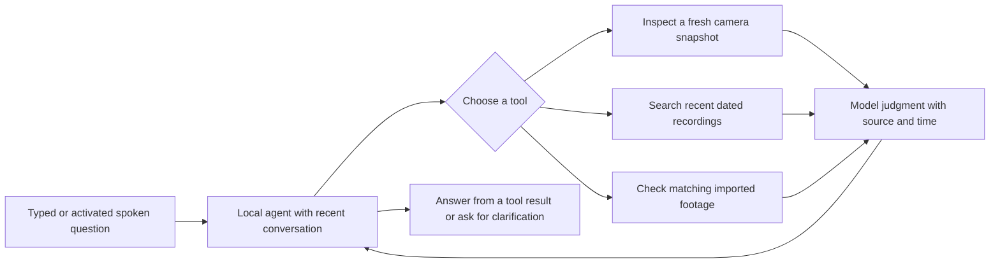
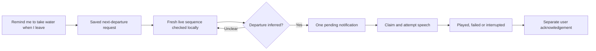

# How the current Nyx companion works

Nyx is being built as a physical companion that helps people stay independent as they age. The laptop is the development setting. The current slice concentrates on two interactions: finding an object through conversation, and remembering a request to speak at the next departure.

## Asking a question

For “Where are my glasses?”, Nyx first checks an available fresh view. If that does not confirm them, the agent can search recent history and widen the time window. “The thin silver reading ones” can refine the query using recent conversation. “Where did you last see them?” can choose historical search directly.

The search encoder compares a text description with indexed visual samples. A close embedding match is only a candidate. The local vision model then checks candidates. Even a model-confirmed result can be wrong, so the answer retains its recording time, source and uncertainty. Unknown dates remain unknown; a matching imported clip cannot establish the latest sighting. No image/audio embedding alignment is required for spoken questions: activated speech is transcribed to text before these tools run.

The agent has a maximum of six decisions. It sees twelve recent completed turns and compact tool results. It does not currently have an unlimited life history or a general saved-fact memory. A previous assistant answer is not fresh visual evidence.

## Watching without constant commentary

While recording is enabled, full video segments save locally. Cheap image differences select changed, pre-change, settled and periodic samples for indexing. A quiet room needs fewer embeddings, while original video remains available. Skipping a sample does not prove nothing happened.

A separate live observer uses small recent frames from the same camera. It does not wait for a saved segment to finish indexing. It checks departure cues with the heavier local model only when a departure reminder is armed. A camera change, pause or stale sequence invalidates that burst.

Unchanged sequences skip the model entirely. For a nominated burst, the first,
middle and last frames are the exact images named in event evidence. The complete
sequence must come after the reminder request; the tail of an older event cannot
satisfy a newly created reminder. Motion is only a reason to look more closely, not
proof of departure.

## Remembering to act

The request survives a restart. Its condition is an observed event, not a clock schedule. Cancel stops future delivery. Displaying text does not count as speaking, and playing speech does not count as the user acknowledging it. Old events are marked missed or interrupted rather than silently replayed after restart.

**The plumbing works, but departure recognition is currently unreliable.** Public-video development cases include missed exits, false triggers and delays. This feature is experimental; a small VLM correctly formatting JSON does not make its interpretation correct. It also does not identify which household member is leaving.

## Where the state lives

| State | Purpose |
| --- | --- |
| Original clips and `capture.sqlite3` | Saved media, segment times, recording interruptions and recovery |
| `index.sqlite3` and selected thumbnails | Searchable sampled observations, offsets, encoder identity and vectors |
| Ephemeral live buffer | At most six small frames for active event checks; no permanent live-frame archive |
| `conversations.sqlite3` | User/assistant conversation, chosen tools and source references |
| `intentions.sqlite3` | Requested next-departure tasks, notification attempts and acknowledgement state |

`agent.py` chooses actions; `companion.py` connects them to the app. `retrieval.py` and `answers.py` retrieve/check evidence. `attention.py` selects samples, `observation.py` bounds live sequences, and `intentions.py` persists requests and delivery state. They share one local inference worker. Fresh event checks and interactive requests precede queued background indexing; a model call already running cannot be preempted.

Visual processing and media stay local. Optional Sarvam handles activated speech transcription and response synthesis. Without a key, typed conversation still works. A running permitted browser page is required for camera/microphone observation; starting the Python process alone opens no hardware.

See [milestones](milestones.md) for actual status, [R8](research/R8-companion-loop.md) for measurements and failures, and [the README](../README.md) for running the demo. General personal recall, timed/recurring reminders, reliable household event recognition and hardware validation remain open.
